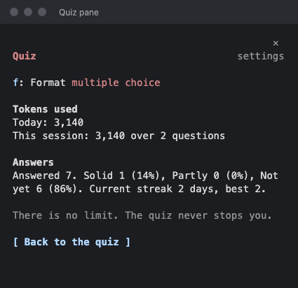

# Session Quiz

Session Quiz is a Claude Code plugin that teaches you while Claude works. When Claude starts on a prompt, the plugin reads what your session has covered and asks you one open-ended question about the big ideas behind it. You answer in a pane beside the chat, and a short grade tells you what you got right and what you missed.

It uses Claude Haiku. There is no limit on how much you learn: the quiz never stops you, and token use shows only in Settings.

## Screenshots

The Quiz pane sits beside the chat while Claude works:


| Free-text question | Feedback | Multiple choice |
| --- | --- | --- |
|  |  |  |

| Go deeper | Settings |
| --- | --- |
|  |  |

The screenshots come from a real session. To retake one, see [Develop](#develop).

## Install

This repository is private. To install it, you need read access to it on GitHub, and your computer needs a git credential for github.com (an SSH key, or `gh auth login` and then `gh auth setup-git`).

At the prompt of a Claude Code terminal session:

```text
/plugin install session-quiz --marketplace papihaj/learning-galore
```

From a shell:

```sh
claude plugin install session-quiz --marketplace papihaj/learning-galore
```

Answer `y` to add the marketplace, then pick a scope. The user scope turns it on in every session.

In the desktop app, click **+** next to the prompt box, then **Plugins**, **Add marketplace** with `papihaj/learning-galore`, then **Add plugin**.

## Use it

1. Send Claude a prompt. A question appears in the **Quiz** pane while Claude works. If the pane is not open, run `/quiz`.
   Under the question, a dim line such as `From: hooks/register.tsx` names the file the idea came from. It only names a file the session actually touched, and adds a line number only when the session cites that line. When no file fits, the line is left out.
2. Press **ctrl+x tab** to move into the pane. The pane says so when it does not have the keyboard.
3. Answer the question:
   - **Free text:** type up to 280 characters, then press Enter or **Submit**. Long answers show in full under the box.
   - **Multiple choice:** press **1** to **4** to select an answer. You can change your choice. Then press **a** or **Submit**.
4. Read the feedback, then press **Next question**, or go back to your work. A new question comes the next time Claude starts working.
5. If you missed the question (a wrong pick, or feedback that starts with "Partly." or "Not yet."), press **d** or **Go deeper** for a short lesson on the gap: the core idea, one example, and the one thing to remember. It shows under the feedback.

Press **s** to skip a question, **f** to switch between free text and multiple choice, and **g** to open Settings.

The first prompt of a session gives no question, because there is nothing to ask about yet.

### Streaks and stats

The plugin counts every answer across sessions. The quiz itself shows no numbers, so it stays about the ideas. Your streak and totals are in Settings. A streak is the number of days in a row, by your local date, with at least one answer. It ends when a whole day passes with no answer.

Each answer is tallied as Solid, Partly, or Not yet. A free-text answer takes the first word of its grade. A multiple-choice answer is Solid when it is right and Not yet when it is wrong. Run `/quiz stats` to see the totals.

## Privacy

To make a question, the plugin sends Haiku a short digest of the session: the text of the last 40 messages, each cut to 600 characters, and one line per tool call with its file path, command, or search pattern. A tool call shows only as that line, not its output. The digest is at most 6,000 characters. To grade a free-text answer, it sends only the question and your answer.

Before the digest leaves the plugin, likely secrets are replaced with `[redacted key]` or `[redacted secret]`:

- API keys and tokens in known formats: Anthropic and OpenAI (`sk-`), GitHub (`ghp_`, `github_pat_`), AWS key IDs (`AKIA`), Slack (`xoxb-`), and JWTs.
- Private key blocks (`-----BEGIN ... PRIVATE KEY-----`).
- `Authorization: Bearer ...` and `Basic ...` values.
- Values of upper-case names that contain KEY, TOKEN, SECRET, PASSWORD, or API, as in `.env` files (`STRIPE_API_KEY=...`).
- Long random-looking strings: 32 or more characters of hex, or of mixed-case letters and digits. Commit hashes count, so they are redacted too.

Tool calls on secrets files (`.env`, `.env.*`, `*.pem`, `id_rsa*`, `credentials*`) are left out entirely. The patterns are in [`hooks/redact.ts`](hooks/redact.ts). They catch common shapes, not every secret, so avoid pasting credentials into a session.

## Customize

### Commands

| Command | What it does |
| --- | --- |
| `/quiz` | Open the pane. |
| `/quiz settings` | Open Settings in the pane: format, tokens used today and this session, and your answer stats. |
| `/quiz now` | Ask a question now. |
| `/quiz stats` | Show your answers, Solid, Partly, and Not yet counts, and your current and best streak. |
| `/quiz free` | Use free-text questions. |
| `/quiz choice` | Use multiple-choice questions. |

The format, stats, and daily token counts are saved across sessions. The pane shows no counts while you answer; press **g** in the pane, or run `/quiz settings`, to see them.

### Cost

Each question costs about 300 to 1,000 tokens with its grade. Most of that is the session text sent to Haiku. The source file comes back in the same reply, so it adds no call. A multiple-choice answer is checked by the plugin, with no second call. **Go deeper** makes one more call, only when you press it, of about 300 to 600 tokens. Nothing is capped: Settings shows tokens used today, the last week by day, and this session. On a Claude subscription, the calls count toward your plan's usage limits.

### In the code

All of these are constants at the top of [`hooks/register.tsx`](hooks/register.tsx):

| Constant | Default | What it controls |
| --- | --- | --- |
| `MODEL` | `haiku` | The model that writes and grades questions. |
| `ASK_MAX_TOKENS` | 400 | Longest reply when making a question. |
| `GRADE_MAX_TOKENS` | 300 | Longest reply when grading. |
| `LESSON_MAX_TOKENS` | 350 | Longest reply for a **Go deeper** lesson. |
| `CONTEXT_CHARS` | 6000 | How much of the session is sent to make a question. |
| `ANSWER_CHARS` | 280 | Longest free-text answer. |
| `DEFAULTS` | free text | The format before you change it. |
| `ACCENT` | `claude` | The accent color, a theme key or a hex color such as `#e0a35a`. A theme key follows your Claude Code theme. |

### Prompts

The prompts that make and grade questions and write **Go deeper** lessons are in [`PROMPTS.md`](PROMPTS.md), with the teaching ideas behind them. Edit the constants `ASK_SYSTEM`, `MOVES`, `CHOICE_RULES`, `SOURCE_RULE`, `GRADE_SYSTEM`, and `LESSON_SYSTEM` in `hooks/register.tsx` to change them.

## Develop

Run a session with the plugin loaded from this folder. It reloads when you save a file:

```sh
claude --plugin-dir .
```

Check the plugin before you push:

```sh
claude plugin validate .
claude plugin test .
npx -p typescript tsc -p .
```

`types/index.d.ts` declares the values the pane keeps in session state.

To retake a screenshot, run the plugin in a tmux session, capture it with colors, and render it with headless Chrome:

```sh
tmux capture-pane -e -p -t <session> > shot.ansi
python3 scripts/term-shot.py shot.ansi docs/screenshots/<name>.png --cols 125:170 --rows 1:30 --title "Quiz pane" --no-bg
```

`--cols` and `--rows` crop to the Quiz pane. Leave them out for the whole window.

## Roadmap

See [TODOS.md](TODOS.md). Next up is letting you name topics to prioritize.
