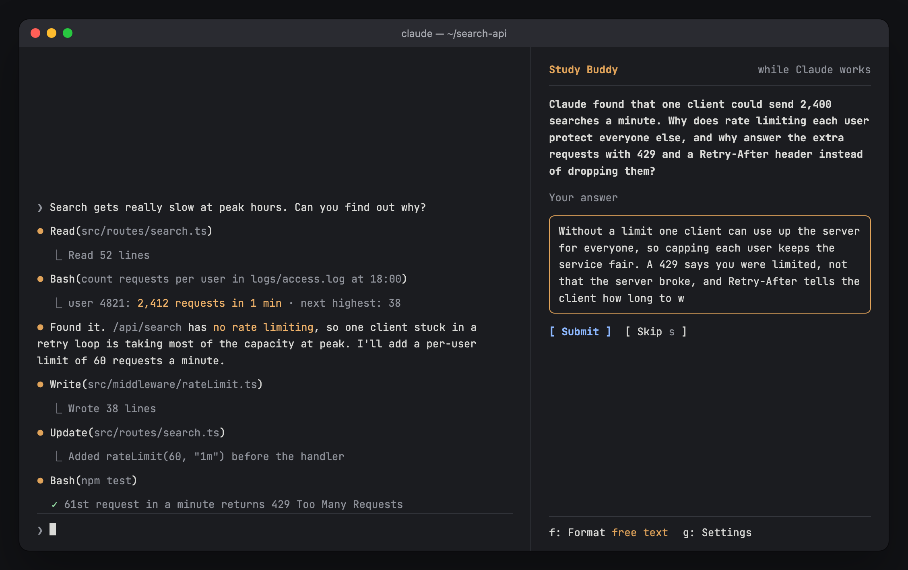

# Study Buddy

A lot of the time when you're building now, it's very rare that you're looking at the code. However, I think it's still important to understand and retain high-level systems design and architectural decisions, so I created this plugin to help me do that.

While Claude works, Study Buddy asks you one question about a key term in what you're building, like debounce, and saves what you learn to a Markdown file in your project.

Claude finds that the search API has no rate limiting, and while it fixes it, Study Buddy asks you about it:


| You answer while Claude works | Feedback, with the key term saved to your notes |
|---|---|
|  |  |

## Install

In Claude Code, run:

```
/plugin install study-buddy --marketplace papihaj/study-buddy-plugin
```

To update, run this in a terminal and restart Claude Code:

```
claude plugin marketplace update study-buddy-plugin && claude plugin update study-buddy@study-buddy-plugin
```

## Use it

Use Claude Code normally. When a question is waiting, open it with `/buddy` and answer in the box, or press `v` (Speak) and say your answer: dictate it into the main prompt box with Claude Code's voice input and press Enter. While Study Buddy is listening, that prompt goes to Study Buddy as your answer, not to Claude. For multiple choice, say the choice's number ("two") or its words. Your terms are saved to `study-buddy-notes/notes.md` in your project.

| Command | What it does |
|---|---|
| `/buddy speak` | Answer the waiting question out loud. |
| `/buddy focus evaluation` | Connect questions to what you're learning. |
| `/buddy free` or `/buddy choice` | Type answers, or pick from choices. |
| `/buddy limit 50000` | Optional daily token limit. There's none unless you set one. |
