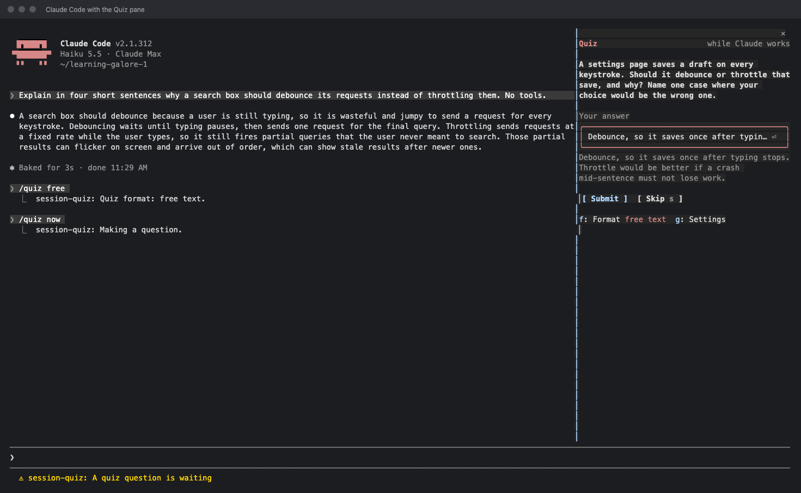
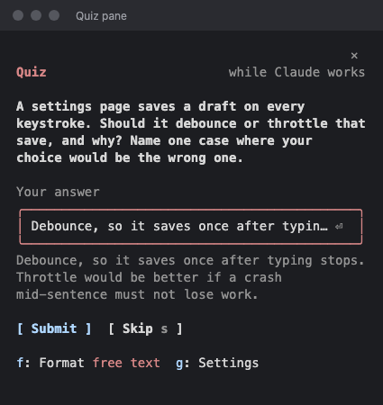
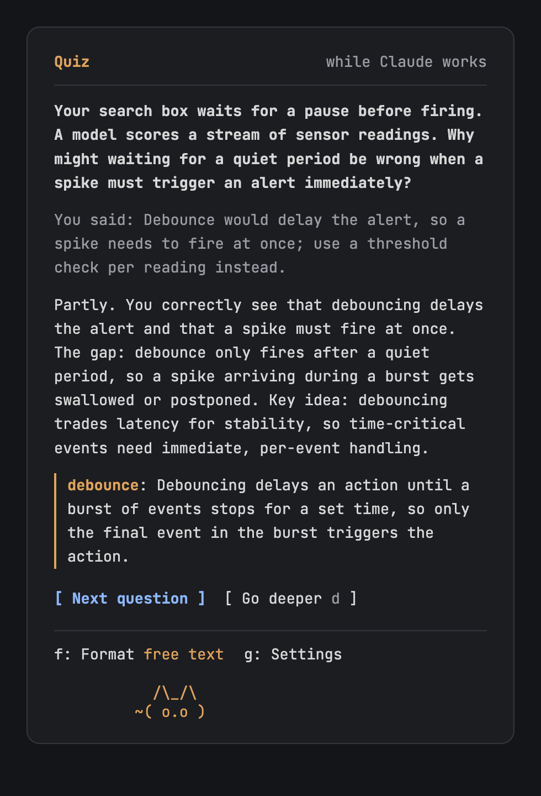
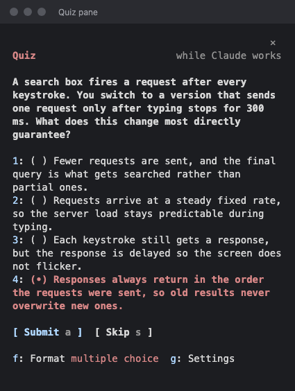
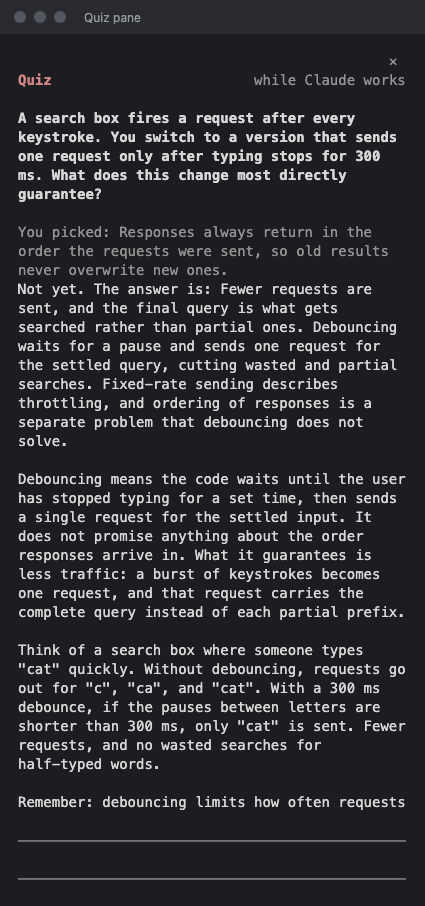
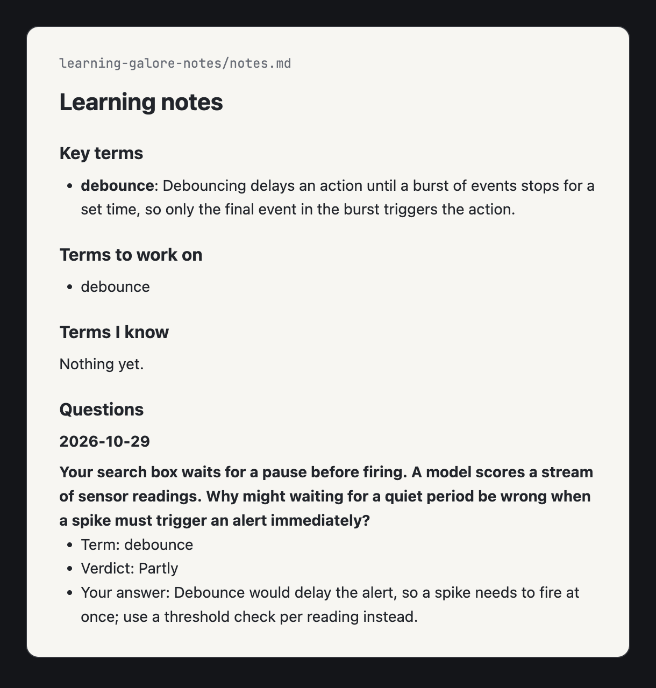

# Session Quiz

I felt like I was doing a lot of stuff with Claude Code but not retaining much of it. I built Session Quiz so I can understand what I'm building, or at least the high-level architecture and systems design ideas behind it.

Session Quiz is a Claude Code plugin. While Claude works, it asks you one short question about a key term in what you're building. If you're adding a debounce to a search box and don't really know what debounce means, this is how you find out, and remember it.

- **Questions while you wait:** a question shows up in a pane beside the chat while Claude is busy.
- **Key terms:** each question is built around one term from your work. After you answer, the term and a one-line definition are highlighted.
- **Answer your way:** type a sentence or two, or pick from multiple choice.
- **Feedback:** a short grade says what you got right and what you missed. After a miss, **Go deeper** gives you a short lesson.
- **Focus areas:** name what you want to get better at, like data science, and questions about your work connect to it.
- **Notes:** your key terms, the ones you know and the ones to work on, are saved to a Markdown file in your project.



| A question | Feedback | Multiple choice |
|---|---|---|
|  |  |  |

| Linked to a focus area | Go deeper | Your notes |
|---|---|---|
|  |  |  |

## How to install

In Claude Code, paste this and press Return:

```
/plugin install session-quiz --marketplace papihaj/learning-galore
```

Answer `y`, then pick the user scope so it works in every session.

## How to use it

1. Use your Claude Code sessions normally.
2. Every so often, the status line says **A quiz question is waiting**. Open the pane with `/quiz`, or press **ctrl+x tab** if it's already open.
3. Answer it. Type an answer and press Return, or press **1** to **4** to pick a choice and **a** to submit. Press **s** to skip.
4. Read the feedback. If you missed it, press **d** for a short lesson.

Press **f** to switch between typing and multiple choice. Press **g** to see how many tokens the quiz has used. There's no limit, so it never stops you.

### Focus areas

Tell it what you want to get better at:

```
/quiz focus data science, distributed systems
```

You don't need to be working on those. The question stays about what you're building, but when there's a real link, it connects it to your area. For example, while you build a search box, you might get a question about batching a stream of sensor readings, with **Linked to: data science** under it. Run `/quiz focus clear` to remove them.

### Your notes

Every answer is saved in the project you're working in, in `learning-galore-notes/notes.md`:

- **Key terms:** every term you've been asked about, with a one-line definition.
- **Terms to work on:** ones you missed last time.
- **Terms I know:** ones you got right last time.
- **Questions:** every question, your answer and the feedback, newest first.

If you don't want the notes in that project's git history, add `learning-galore-notes/` to its `.gitignore`.

## Commands

| Command | What it does |
|---|---|
| `/quiz` | Open the Quiz pane. |
| `/quiz now` | Ask a question now. |
| `/quiz free` or `/quiz choice` | Type answers, or pick from multiple choice. |
| `/quiz focus <areas>` | Set up to 5 focus areas. `/quiz focus` lists them. |
| `/quiz notes` | Show where your notes are. |
| `/quiz settings` | Show the format and the tokens used. |

## Privacy

The quiz sends Claude Haiku a short summary of your session: the last 40 messages, cut short, and the names of the files and commands Claude used. Before anything leaves your computer, it removes things that look like secrets, such as API keys, tokens, passwords in `.env` files and private keys, and it skips secret files entirely. Your answers are cleaned the same way before they're saved to your notes. The patterns are in [`hooks/redact.ts`](hooks/redact.ts).

Each question costs about 300 to 1,000 tokens. On a Claude subscription, that counts toward your usage limits.

## Make it yours

The prompts and the teaching ideas behind them are in [`PROMPTS.md`](PROMPTS.md). The settings, like the model and the longest answer, are at the top of [`hooks/register.tsx`](hooks/register.tsx).

To work on the plugin, run `claude --plugin-dir .` in this folder. Check it with `claude plugin validate .` and `claude plugin test .`. The screenshots are made with `scripts/term-shot.py`.
