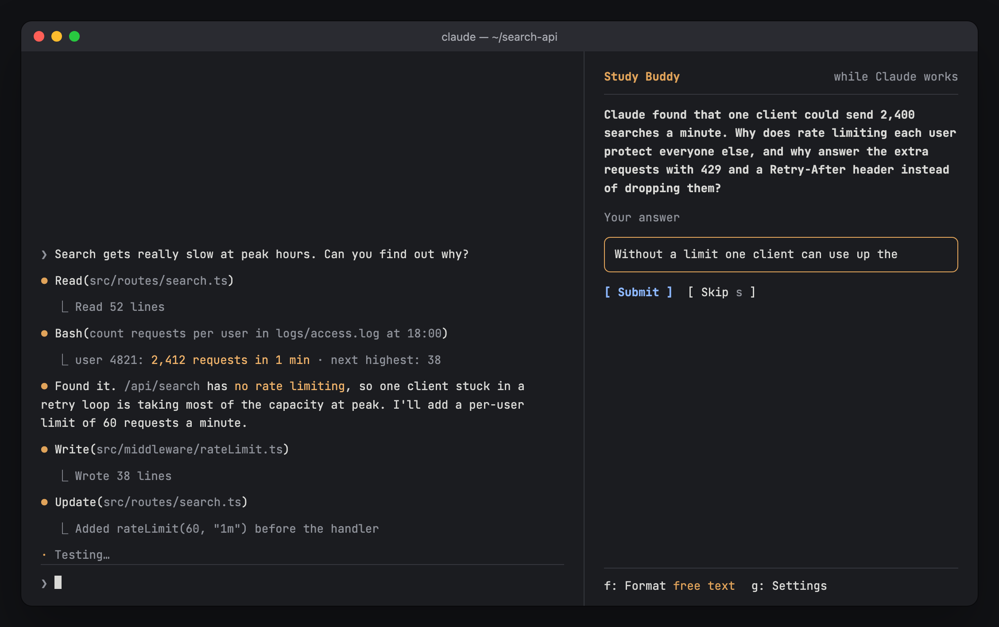
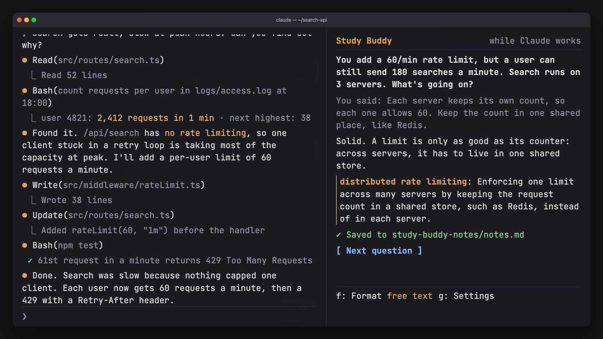

# Study Buddy

A lot of the time when you're building now, it's very rare that you're looking at the code. However, I think it's still important to understand and retain high-level systems design and architectural decisions, so I created this plugin to help me do that.

While Claude works, Study Buddy asks you one question about a key term in what you're building, and saves what you learn to your project.





[Watch the 15-second demo](docs/demo.mp4)

## Install

```
/plugin install study-buddy --marketplace papihaj/study-buddy-plugin
```

## Use it

1. Use Claude Code normally.
2. A question shows up in the Study Buddy pane. Press `ctrl+x` then `Tab` to move into it.
3. Type your answer, or pick a choice.

Key terms you learn are saved to `study-buddy-notes/notes.md`.

| Command | What it does |
|---|---|
| `/buddy` | Open the pane. |
| `/buddy now` | Ask a question now. |
| `/buddy focus evaluation, testing` | Connect questions to what you're learning. `/buddy focus clear` removes them. |
| `/buddy free` or `/buddy choice` | Type answers, or pick from choices. |
| `/buddy limit 50000` | Optional daily token limit. `/buddy limit off` removes it. |
| `/buddy settings` | See tokens used today and this session. |
| `/buddy notes` | Show where your notes are saved. |

## Update

```
claude plugin marketplace update study-buddy-plugin && claude plugin update study-buddy@study-buddy-plugin
```

Then restart Claude Code.

## Develop

Run `claude --plugin-dir .` once. It loads the plugin and writes the type declarations to `.claude-plugin/types/`. Then `npx -p typescript tsc -p .` type-checks and `claude plugin test .` runs the tests.

## License

[MIT](LICENSE)
